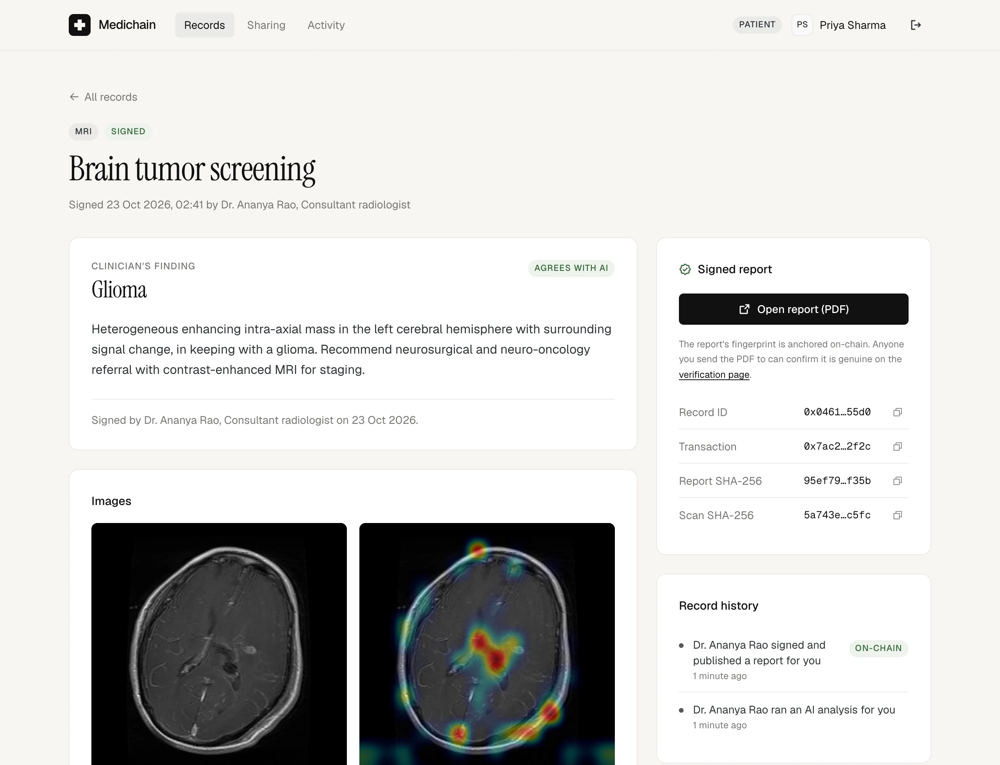
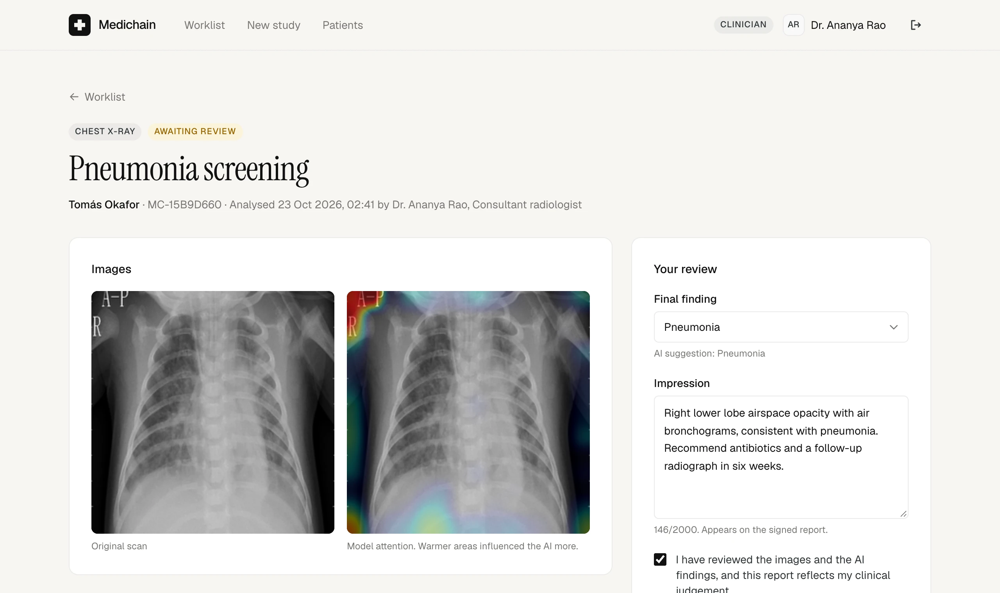
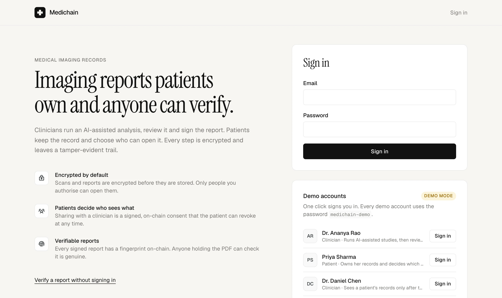
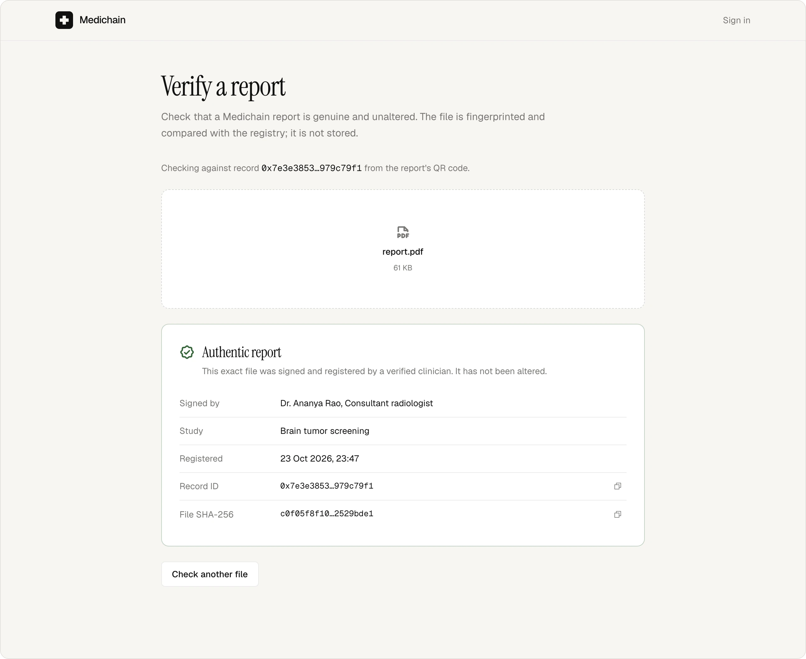
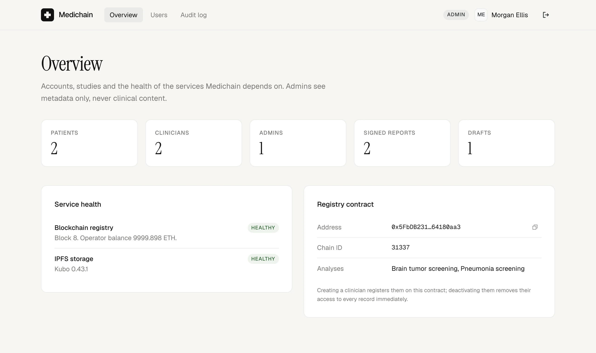

<div align="center">


# Medichain

**AI-assisted medical imaging reports that patients own and anyone can verify.**

[](https://github.com/HunarAgrawal/medichain/actions/workflows/ci.yml)
[](LICENSE)
[](backend/pyproject.toml)
[](frontend/package.json)
[](https://doi.org/10.1109/ACET67282.2025.11430313)

[Try it](#try-it) · [How it works](#how-it-works) · [Security model](#security-model) · [Citation](#citation)



</div>

Medichain is a role-based platform for AI-assisted medical imaging reports:
- Clinicians analyse a scan with a vision model, review the result and sign the report.
- Patients own their records and decide which clinicians can open them.
- Every signed report is encrypted at rest, anchored on an EVM chain and verifiable by anyone who holds the PDF.

> **Research prototype.** Not a medical device and not clinically validated. AI findings are
> decision support and must be reviewed by a qualified clinician. Use synthetic or consented data.

## What each role can do

| Role | In the app |
| --- | --- |
| **Clinician** | Run an AI analysis on a brain MRI or chest X-ray, review findings and the attention heatmap, write an impression and sign the report. Open records patients have shared. |
| **Patient** | Read signed reports, open the PDF and scan, share records with clinicians or withdraw access (an on-chain consent), and see who opened each record. |
| **Admin** | Create accounts (new clinicians are verified on-chain automatically), deactivate users (their access ends at once), monitor services and read the audit log. Admins never see clinical content. |
| **Anyone** | Check that a report PDF is genuine and unaltered on the public `/verify` page. |

<table>
  <tr>
    <td width="50%" valign="top">
      
      <br /><sub><b>Clinician review.</b> AI findings and heatmap beside the sign-off form.</sub>
    </td>
    <td width="50%" valign="top">
      
      <br /><sub><b>Sign in.</b> One-click demo accounts for every role.</sub>
    </td>
  </tr>
  <tr>
    <td width="50%" valign="top">
      
      <br /><sub><b>Public verification.</b> Anyone can check a report PDF against the chain.</sub>
    </td>
    <td width="50%" valign="top">
      
      <br /><sub><b>Admin overview.</b> Accounts, studies and service health, with no clinical data.</sub>
    </td>
  </tr>
</table>

## Try it

Prerequisites: Python 3.12, Node.js 22 and Docker.

```bash
make setup      # Python venv, npm installs, backend/.env with freshly generated keys
make ipfs       # local IPFS node (Docker)
make chain      # terminal 1: local blockchain on :8545
make deploy     # deploy the registry contract
make seed       # demo accounts and sample studies
make backend    # terminal 2: API on :8000
make frontend   # terminal 3: app on http://localhost:3000
```

The login page lists the demo accounts; one click signs you in. They all use the password
`medichain-demo`.

| Account | Role | Starts with |
| --- | --- | --- |
| Dr. Ananya Rao | Clinician | One draft study awaiting review (Tomás Okafor) |
| Priya Sharma | Patient | Two signed reports, already shared with Dr. Chen |
| Dr. Daniel Chen | Clinician | Access to Priya's records only |
| Tomás Okafor | Patient | Nothing signed yet |
| Morgan Ellis | Admin | All accounts and the audit log |

A five-minute walkthrough: sign in as **Dr. Rao**, review and sign Tomás's chest X-ray. Sign in as
**Tomás** and open the report. Sign in as **Dr. Chen** and confirm you can open Priya's records but
not Tomás's. Download a report as **Priya** and check it on `/verify`. Finish in the **admin**
audit log, where every step appears. Sample scans for new studies are in [`samples/`](samples/).

The local chain forgets everything when it restarts. After restarting `make chain`, run
`make fresh` to redeploy, reset the local database and reseed.

## How it works

```text
Clinician                     Medichain API                            Chain / IPFS
─────────                     ─────────────                            ────────────
upload scan ───────────────▶  validate, run ViT, attention heatmap
                              save draft (scan sealed with AES-GCM)
review + sign ─────────────▶  render PDF (findings, review, QR)
                              seal scan + PDF, pin to IPFS ─────────▶  IPFS (ciphertext only)
                              publishRecord(recordId, patient,
                                reportSHA256, CIDs) signed with  ────▶  MediChainRegistry
                                the clinician's key

Patient opens a report ────▶  getRecord() from the patient's address
                              (the contract decides), fetch CID,
                              decrypt, check SHA-256 against chain ──▶  read-only calls
Patient shares ────────────▶  grantAccess(clinician) signed with the
                              patient's key ──────────────────────────▶  on-chain consent
Anyone verifies a PDF ─────▶  SHA-256 → verifyReport() ──────────────▶  public lookup
```

## Security model

| Concern | How it is handled |
| --- | --- |
| Sign-in | Email and password hashed with scrypt; timing-safe checks; per-IP and per-account rate limits. Opaque server-side sessions in an `HttpOnly`, `SameSite=Strict` cookie, revocable at any time (logout, password change, deactivation). |
| Request forgery | Same-origin API, strict CORS allowlist, and a required `X-Requested-With` header on every state-changing request. |
| Authorization | Role guards on every endpoint. For published records the contract is the authority: the API calls `getRecord` *from the user's address*. Deactivating a clinician removes their registry status and with it all access. |
| Keys | Each patient and clinician has a platform-held Ethereum key, sealed with `WALLET_ENCRYPTION_KEY` and bound to the account. On-chain actions are signed by the person who took them. An operator key owns the registry and funds gas. |
| Confidentiality | Scans and reports are sealed with AES-256-GCM before they reach IPFS, bound to their study and file kind. The chain stores no names or IDs: patients are addresses and record IDs are random. Admins see metadata only. |
| Integrity | The report's SHA-256 is anchored on-chain, checked on every download, and publicly verifiable. Ciphertexts cannot be swapped between records. |
| Hardening | Upload type, size and pixel limits; decompression-bomb guard; strict validation; security headers; no stack traces in responses; logs record route templates, never IDs; models load only from `safetensors`; unsafe production settings refuse to start. |
| Public on-chain | Addresses, record IDs, CIDs of ciphertext, report hashes and timestamps. |

## Models

| Analysis | Model | Classes | Reported val. accuracy |
| --- | --- | --- | --- |
| Brain tumor screening (MRI) | [`Hemgg/brain-tumor-classification`](https://huggingface.co/Hemgg/brain-tumor-classification) | glioma, meningioma, pituitary, no tumor | 97.6% |
| Pneumonia screening (chest X-ray) | [`lxyuan/vit-xray-pneumonia-classification`](https://huggingface.co/lxyuan/vit-xray-pneumonia-classification) | normal, pneumonia | 97.4% |

Both are ViT-B/16 fine-tunes (86M parameters, Apache-2.0), about 70 ms per image on CPU. The
accuracies are the authors' validation figures, not clinical validation. Weights download once
(about 700 MB). Swap models with `BRAIN_TUMOR_MODEL` / `CHEST_XRAY_MODEL`; ViT models get
attention rollout heatmaps and CNNs get Grad-CAM.

## Repository layout

```text
backend/     FastAPI service: accounts, studies, sharing, admin, verification (+ tests)
frontend/    React 19 + TypeScript + Tailwind app with patient, clinician and admin areas
contracts/   MediChainRegistry.sol, Hardhat 3 tests, deployment and the exported ABI
samples/     Openly licensed sample scans (see samples/README.md)
Makefile     One entry point for setup, running, testing and linting (`make help`)
```

## API

All routes are under `/api/v1`. Interactive docs are at `/docs` when `ENABLE_DOCS=true`.

| Area | Endpoints |
| --- | --- |
| Public | `GET /health`, `GET /meta`, `POST /verify` |
| Session | `POST /auth/login`, `POST /auth/logout`, `GET /auth/me`, `POST /auth/password` |
| Studies | `POST /studies`, `GET /studies`, `GET /studies/{id}`, `POST /studies/{id}/publish`, `DELETE /studies/{id}`, `GET /studies/{id}/files/{scan\|report\|heatmap}`, `GET /studies/{id}/activity` |
| People | `GET/POST /sharing`, `DELETE /sharing/{clinician_id}`, `GET /directory/clinicians`, `GET /directory/patients`, `GET /patients`, `GET /activity` |
| Admin | `GET /admin/overview`, `GET/POST /admin/users`, `PATCH /admin/users/{id}`, `GET /admin/audit` |

## Configuration

Every backend setting is documented in [`backend/.env.example`](backend/.env.example); `make env`
creates `backend/.env` with new keys. The frontend needs no configuration: it calls `/api` on its
own origin, and Vite proxies that to the API in development.

## Deploying beyond localhost

- **Contract:** in `contracts/`, store credentials with `npx hardhat keystore set SEPOLIA_RPC_URL`
  and `npx hardhat keystore set SEPOLIA_PRIVATE_KEY`, then run `npm run deploy:sepolia`.
- **Backend:** set `ENVIRONMENT=production`, `DEMO_MODE=false`, `COOKIE_SECURE=true`,
  `ENABLE_DOCS=false`, a real `PUBLIC_APP_URL`, a PostgreSQL `DATABASE_URL`
  (`postgresql+asyncpg://…`, with `asyncpg` installed), the chain settings and a funded
  `OPERATOR_PRIVATE_KEY` that owns the contract, `IPFS_PROVIDER=pinata` with `PINATA_JWT`, and
  `EXPLORER_URL`. Run `uvicorn app.main:create_app --factory --proxy-headers --no-access-log`.
- **Frontend:** `npm run build`, then serve `frontend/dist` and the API from one origin through a
  reverse proxy, routing `/api` to the backend.

## Limitations

- The models are community fine-tunes, not clinically validated. PNG and JPEG only (no DICOM).
- Keys are custodial and live in the database, sealed with an environment key. Production should
  use a KMS or HSM, and could let users bring their own wallet.
- Sharing covers all of a patient's records; per-record sharing is not implemented.
- The schema is created on startup; there are no migrations yet.
- There is no password reset, email verification or multi-factor sign-in yet.

## Contributing

Contributions are welcome. Start with [CONTRIBUTING.md](CONTRIBUTING.md) and the
[code of conduct](CODE_OF_CONDUCT.md). Report vulnerabilities privately as described in
[SECURITY.md](SECURITY.md). Release notes are in [CHANGELOG.md](CHANGELOG.md).

## Citation

The design is described in an early, high-level paper. This repository is the reference
implementation and supersedes its details. Use GitHub's **Cite this repository** button, or:

```bibtex
@inproceedings{agrawal2025trusted,
  title     = {Trusted Medical Imaging: A Blockchain Enabled Deep Learning Framework for Secure Healthcare},
  author    = {Agrawal, Hunar Sajjan and Bhatnagar, Vaibhav and Kumar, Ashish and Singla, Kanika},
  booktitle = {2025 2nd International Conference on Advanced Computing and Emerging Technologies (ACET)},
  pages     = {1--6},
  year      = {2025},
  publisher = {IEEE},
  doi       = {10.1109/ACET67282.2025.11430313}
}
```

## License

Medichain is free software under the [GNU Affero General Public License v3.0](LICENSE)
(`AGPL-3.0-only`). You may use, study, modify and share it. If you distribute a modified version,
**or run one as a network service**, you must make its complete source code available to its
users under the same license. The app's footer links to the source for that reason.

Third-party material keeps its own license: the sample scans in `samples/` are CC BY 4.0 (see
[`samples/README.md`](samples/README.md)), and the AI models, downloaded at runtime and not
redistributed here, are Apache-2.0.
