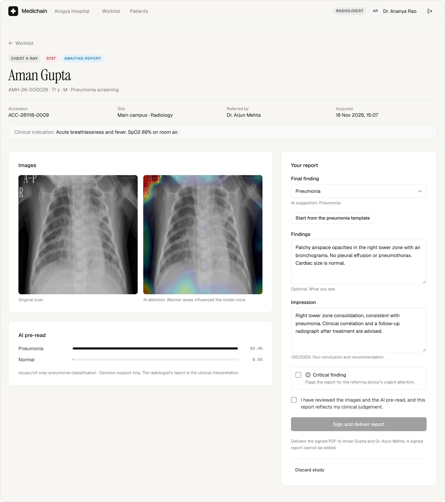
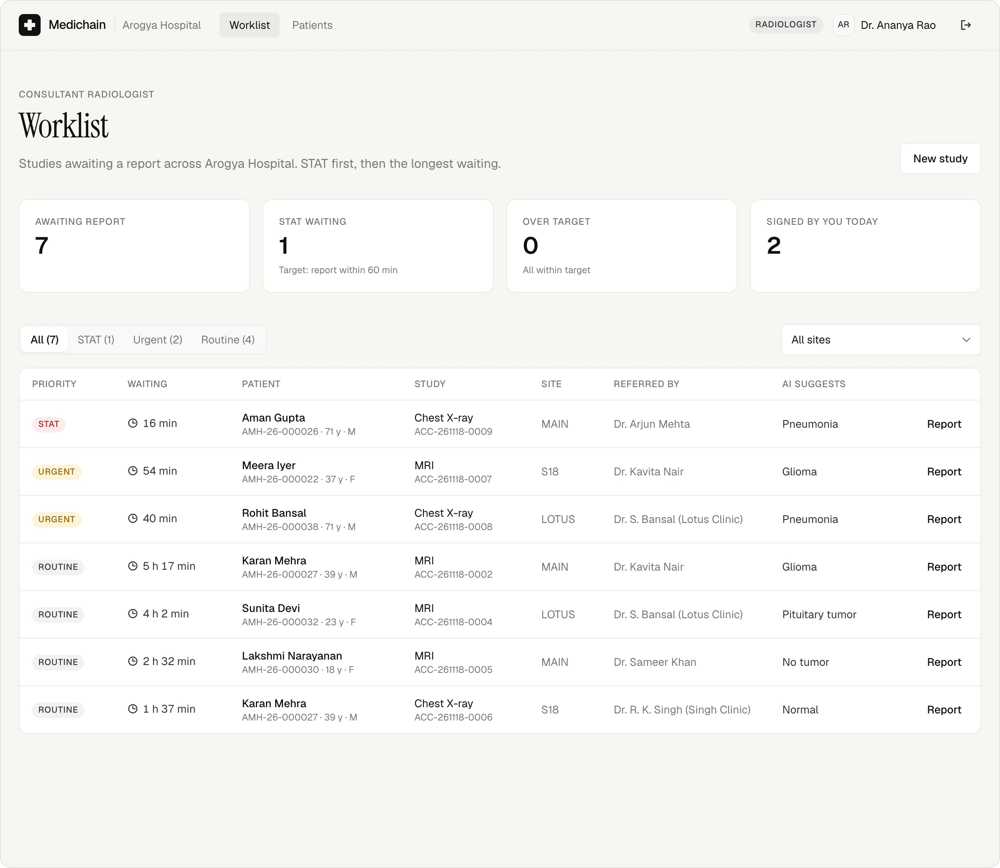
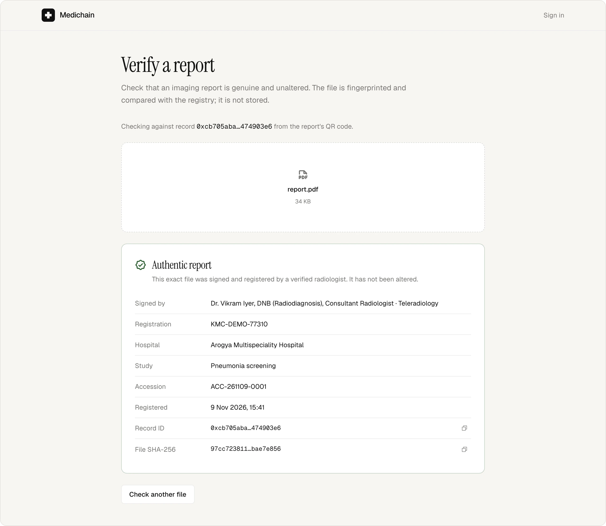
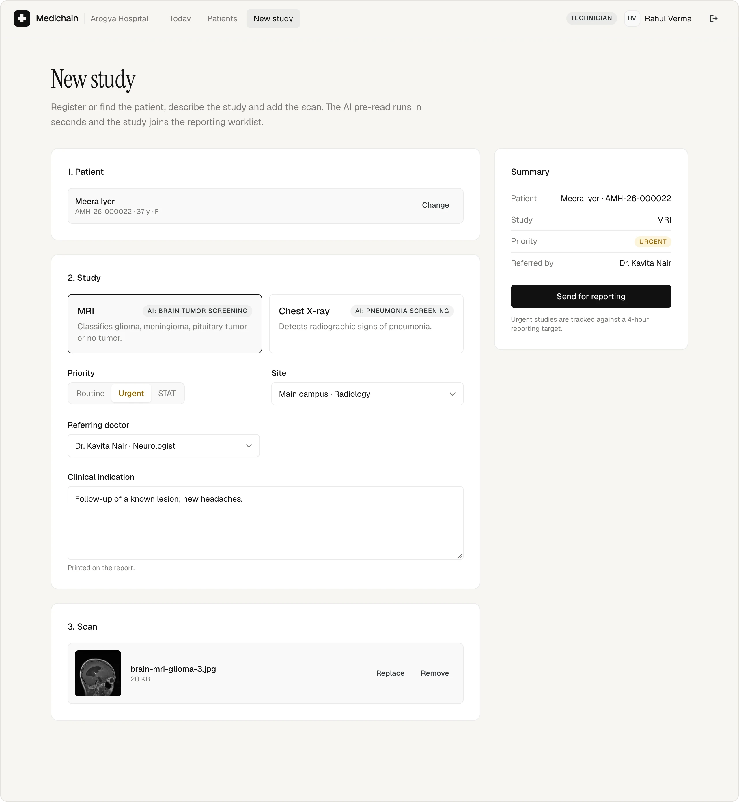
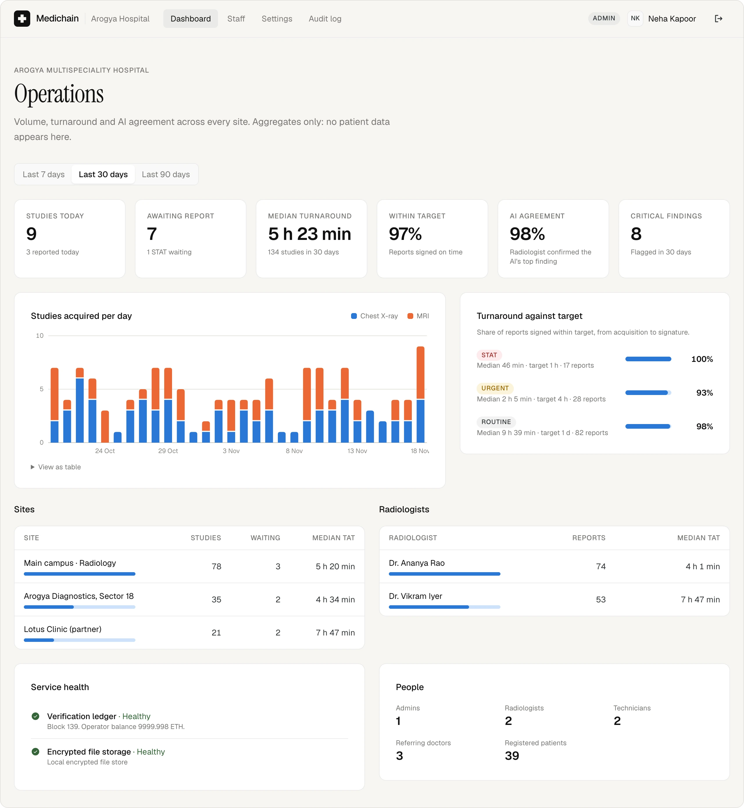

<div align="center">

<picture>
  <source media="(prefers-color-scheme: dark)" srcset="https://raw.githubusercontent.com/HunarAgrawal/medichain/main/docs/images/logo-dark.svg" />
  
</picture>

# Medichain

**Radiology reporting for hospitals, imaging centres and teleradiology: AI pre-reads,
radiologist sign-off, instant delivery and reports anyone can verify.**

[](https://github.com/HunarAgrawal/medichain/actions/workflows/ci.yml)
[](LICENSE)
[](backend/pyproject.toml)
[](frontend/package.json)
[](https://doi.org/10.1109/ACET67282.2025.11430313)

[Try it](#try-it) · [How it works](#how-it-works) · [Security model](#security-model) · [Demo guide](docs/demo-guide.md)



</div>

Medichain runs the imaging workflow from the front desk to the patient:

1. **Register and acquire.** The technician registers the patient (UHID issued, ABHA number
   optional), records the referring doctor and priority, and uploads the scan.
2. **AI pre-read.** A vision model suggests a finding and shows where it looked, in seconds.
3. **Report and sign.** A radiologist works the worklist (STAT first, turnaround tracked against
   targets), writes the findings and impression, flags critical results and signs.
4. **Deliver and verify.** The PDF, on the hospital's letterhead, reaches the referring doctor and
   the patient at once. Its fingerprint is registered on a tamper-evident ledger, and anyone can
   check a copy by scanning its QR code.

> **Not a medical device.** The AI models are research-grade decision support and are not
> clinically validated. Every report is the radiologist's interpretation. Use the demo's
> fictional data, or properly consented data, only.

## Who it is for

| Organization | How it works for them |
| --- | --- |
| **Hospital** | One worklist for the radiology department; OPD and ward doctors receive reports the moment they are signed; management sees turnaround and workload. |
| **Imaging centre** | Fast walk-in registration, reports for outside doctors without phone calls, and verifiable reports patients can share anywhere. |
| **Teleradiology** | Partner sites upload, remote radiologists report, and turnaround is tracked per site. |

One workspace can mix all three: the demo hospital has an in-house department, an imaging centre
and a partner clinic reported remotely.

## What each role does

| Role | In the app |
| --- | --- |
| **Technician** | Registers patients, starts studies (modality, priority, referring doctor, indication, scan) and tracks the day's studies. |
| **Radiologist** | Works the worklist, reviews the scan, heatmap and AI pre-read, writes the report from a template, flags critical findings and signs. |
| **Referring doctor** | Receives reports for patients they referred, critical findings first, and records patients share with them. |
| **Patient** | Reads their reports, shares them with doctors or withdraws access, and sees who opened each one. |
| **Admin** | Sees volume, turnaround, AI agreement and workload by site and radiologist; manages staff, sites and the letterhead; reads the audit log. Never sees clinical content. |
| **Anyone** | Checks that a report PDF is genuine and unaltered on the public `/verify` page. |

<table>
  <tr>
    <td width="50%" valign="top">
      
      <br /><sub><b>Worklist.</b> STAT first, waiting times against targets, across every site.</sub>
    </td>
    <td width="50%" valign="top">
      
      <br /><sub><b>Verification.</b> Anyone can confirm a report is genuine and unaltered.</sub>
    </td>
  </tr>
  <tr>
    <td width="50%" valign="top">
      
      <br /><sub><b>Front desk.</b> Register, describe the study and send it for reporting.</sub>
    </td>
    <td width="50%" valign="top">
      
      <br /><sub><b>Operations.</b> Turnaround, AI agreement and workload, with no patient data.</sub>
    </td>
  </tr>
</table>

## Try it

**The whole demo in one command** (needs Docker; the first build takes a few minutes):

```bash
make demo        # then open http://localhost:3000
```

The landing page lets you enter as any role, and the bar at the bottom of the screen switches
roles in one click. Every start is a fresh demo hospital with a month of history. The
[demo guide](docs/demo-guide.md) walks through a ten-minute client presentation, and
[hosted-demo.md](docs/hosted-demo.md) puts the same demo on a free public link.

| Account | Role | What to try |
| --- | --- | --- |
| Rahul Verma | Technician | Register a walk-in patient and send a chest X-ray for reporting, using a sample scan |
| Dr. Ananya Rao | Radiologist | Report the STAT chest X-ray at the top of the worklist |
| Dr. Vikram Iyer | Teleradiologist | Report the partner clinic's studies remotely |
| Dr. Arjun Mehta | Referring doctor | See reports arrive the moment they are signed |
| Priya Sharma | Patient | Open a report, share it with a doctor, see who opened it |
| Neha Kapoor | Admin | Dashboard, staff, sites, letterhead and audit log |

All demo accounts use the password `medichain-demo`.

### Development setup

Prerequisites: Python 3.12 and Node.js 22.

```bash
make setup      # Python venv, npm installs, backend/.env with freshly generated keys
make chain      # terminal 1: local chain on :8545 (its clock starts 45 days ago)
make deploy     # deploy the registry contract
make seed       # the demo hospital, staff, patients and a month of studies
make backend    # terminal 2: API on :8000
make frontend   # terminal 3: app on http://localhost:3000
```

The local chain forgets everything when it restarts. After restarting `make chain`, run
`make fresh` to redeploy, reset the database and reseed. Scans and reports are stored encrypted in
`backend/data/files`; set `STORAGE_PROVIDER=kubo` and run `make ipfs` to use IPFS instead.

## How it works

```text
Technician                    Medichain API                           Ledger / storage
──────────                    ─────────────                           ────────────────
register patient ──────────▶  UHID, custodial wallet
upload scan ───────────────▶  validate, run ViT, attention heatmap
                              queue on the worklist (scan sealed)
Radiologist
───────────
report + sign ─────────────▶  render PDF on the letterhead (QR)
                              seal scan + PDF, store ciphertext ─────▶  encrypted file store
                              publishRecord(recordId, patient,
                                referrer, reportSHA256, IDs) ────────▶  MediChainRegistry
                                signed with the radiologist's key

Doctor or patient opens it ▶  getRecord() from their own address
                              (the contract decides), decrypt,
                              check SHA-256 against the ledger ──────▶  read-only calls
Patient shares ────────────▶  grantAccess(doctor), patient's key ────▶  on-chain consent
Anyone verifies a PDF ─────▶  SHA-256 → verifyReport() ──────────────▶  public lookup
```

## Security model

| Concern | How it is handled |
| --- | --- |
| Tenancy | Every patient, study, site and audit entry belongs to one organization. Every query is scoped to the signed-in user's organization; other tenants' records look like missing ones. |
| Sign-in | Email and password hashed with scrypt; timing-safe checks; per-IP and per-account rate limits. Opaque server-side sessions in an `HttpOnly`, `SameSite=Strict` cookie, revocable at any time. Patients without portal access cannot sign in at all. |
| Request forgery | Same-origin API, strict CORS allowlist, and a required `X-Requested-With` header on every state-changing request. |
| Authorization | Role guards on every endpoint. Technicians and waiting referrers see status, never clinical content. For signed reports the contract is the authority: the API calls `getRecord` *from the user's address*, and only the patient, the signing radiologist, the referring doctor and doctors the patient chose can read it. Deactivating a clinician removes their registry status and with it all access. |
| Keys | Each patient, radiologist and doctor has a platform-held Ethereum key, sealed with `WALLET_ENCRYPTION_KEY` and bound to the account. On-chain actions are signed by the person who took them. An operator key owns the registry. |
| Confidentiality | Scans and reports are sealed with AES-256-GCM before storage, bound to their study and file kind. The ledger holds no names or IDs: patients are addresses and record IDs are random. Admins see aggregates and metadata only. |
| Integrity | The report's SHA-256 is anchored on the ledger, checked on every download, and publicly verifiable. Ciphertexts cannot be swapped between records. |
| Hardening | Upload type, size and pixel limits; decompression-bomb guard; strict validation; security headers and a strict CSP; no stack traces in responses; logs record route templates, never IDs; models load only from `safetensors`; unsafe production settings refuse to start. |
| Public on the ledger | Addresses, record IDs, IDs of ciphertext files, report hashes and timestamps. |

## Models

| Analysis | Model | Classes | Reported val. accuracy |
| --- | --- | --- | --- |
| Brain tumor screening (MRI) | [`Hemgg/brain-tumor-classification`](https://huggingface.co/Hemgg/brain-tumor-classification) | glioma, meningioma, pituitary, no tumor | 97.6% |
| Pneumonia screening (chest X-ray) | [`lxyuan/vit-xray-pneumonia-classification`](https://huggingface.co/lxyuan/vit-xray-pneumonia-classification) | normal, pneumonia | 97.4% |

Both are ViT-B/16 fine-tunes (86M parameters, Apache-2.0), about 70 ms per image on CPU. The
accuracies are the authors' validation figures, not clinical validation. Swap models with
`BRAIN_TUMOR_MODEL` / `CHEST_XRAY_MODEL`; ViT models get attention rollout heatmaps and CNNs get
Grad-CAM.

## Repository layout

```text
backend/     FastAPI service: tenancy, patients, studies, reporting, sharing, admin (+ tests)
frontend/    React 19 + TypeScript + Tailwind app with a page set for each role
contracts/   MediChainRegistry.sol, Hardhat 3 tests, deployment and the exported ABI
deploy/      The self-contained demo image (Dockerfile at the root) and the Hugging Face Space
docs/        Demo guide, hosted demo, screenshots
samples/     Openly licensed sample scans (see samples/README.md)
Makefile     One entry point for setup, running, testing and linting (`make help`)
```

## API

All routes are under `/api/v1`. Interactive docs are at `/docs` when `ENABLE_DOCS=true`.

| Area | Endpoints |
| --- | --- |
| Public | `GET /health`, `GET /meta`, `POST /verify` |
| Session | `POST /auth/login`, `POST /auth/logout`, `GET /auth/me`, `POST /auth/password` |
| Patients | `GET/POST /patients`, `GET /patients/{id}`, `POST /patients/{id}/portal` |
| Studies | `POST /studies`, `GET /studies`, `GET /studies/{id}`, `POST /studies/{id}/publish`, `DELETE /studies/{id}`, `GET /studies/{id}/files/{scan\|report\|heatmap}`, `GET /studies/{id}/activity` |
| People | `GET/POST /sharing`, `DELETE /sharing/{clinician_id}`, `GET /directory/clinicians`, `GET /sites`, `GET /activity` |
| Admin | `GET /admin/dashboard`, `GET/POST /admin/users`, `PATCH /admin/users/{id}`, `GET/PATCH /admin/organization`, `GET/POST /admin/sites`, `GET /admin/audit` |

## Configuration

Every backend setting is documented in [`backend/.env.example`](backend/.env.example); `make env`
creates `backend/.env` with new keys. The frontend needs no configuration: it calls `/api` on its
own origin, and Vite proxies that to the API in development.

## Deploying beyond the demo

- **Ledger:** run the registry on a private (permissioned) EVM network for the client, or a public
  testnet for evaluation. In `contracts/`, store credentials with `npx hardhat keystore set …` and
  deploy with Hardhat Ignition.
- **Backend:** set `ENVIRONMENT=production`, `DEMO_MODE=false`, `COOKIE_SECURE=true`,
  `ENABLE_DOCS=false`, a real `PUBLIC_APP_URL`, a PostgreSQL `DATABASE_URL`
  (`postgresql+asyncpg://…`, with `asyncpg` installed), the chain settings, an
  `OPERATOR_PRIVATE_KEY` that owns the contract, and a storage provider (`local` on an encrypted
  volume in an Indian region, or IPFS). Set `STATIC_DIR=../frontend/dist` to serve the web app from
  the API, or serve it from a reverse proxy that routes `/api` to the backend.

## Before clinical use

Medichain is ready to demonstrate and to pilot on non-clinical or consented data. A production
deployment for a hospital needs, at least:

- **Imaging integration:** DICOM import and PACS, HL7 and FHIR integration (today: PNG/JPEG upload).
- **Clinical validation** of the models on the client's own data, and an assessment under India's
  medical device rules (CDSCO) for AI that informs diagnosis.
- **ABDM integration** as a health information provider (ABHA numbers are captured today).
- **Identity:** SSO, multi-factor sign-in, password reset, and a KMS or HSM for keys.
- **Operations:** database migrations, backups, monitoring, an SLA and a data processing agreement.
- **Reporting depth:** more modalities, addenda to signed reports, and critical-result
  acknowledgement.

## Contributing

Contributions are welcome. Start with [CONTRIBUTING.md](CONTRIBUTING.md) and the
[code of conduct](CODE_OF_CONDUCT.md). Report vulnerabilities privately as described in
[SECURITY.md](SECURITY.md). Release notes are in [CHANGELOG.md](CHANGELOG.md).

## Citation

The design is described in an early, high-level paper. This repository is the reference
implementation and supersedes its details. Use GitHub's **Cite this repository** button, or:

```bibtex
@inproceedings{agrawal2025trusted,
  title     = {Trusted Medical Imaging: A Blockchain Enabled Deep Learning
               Framework for Secure Healthcare},
  author    = {Agrawal, Hunar Sajjan and Bhatnagar, Vaibhav and Kumar, Ashish
               and Singla, Kanika},
  booktitle = {2025 2nd International Conference on Advanced Computing and
               Emerging Technologies (ACET)},
  pages     = {1--6},
  year      = {2025},
  publisher = {IEEE},
  doi       = {10.1109/ACET67282.2025.11430313}
}
```

## License

Medichain is free software under the [GNU Affero General Public License v3.0](LICENSE)
(`AGPL-3.0-only`). You may use, study, modify and share it. If you distribute a modified version,
**or run one as a network service**, you must make its complete source code available to its
users under the same license. The app's footer links to the source for that reason.

Third-party material keeps its own license: the sample scans in `samples/` are CC BY 4.0 (see
[`samples/README.md`](samples/README.md)), and the AI models, downloaded at runtime and not
redistributed here, are Apache-2.0.
